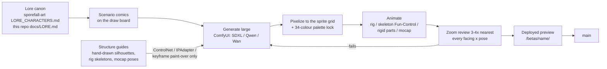

# Art direction: the owner's standing rules

These are Aaron's rules for anything the player sees. Each one was paid for by a
rejected result. They bind every agent and every machine. Dated quotes are his words.

## How art is made

- **Generated, never hand-drawn.** Shipped art comes out of generation. Hand-placed
  pixels, silhouettes, rig skeletons and motion-capture poses are allowed only as
  structure inputs (ControlNet, IPAdapter, a keyframe paint-over). 2026-11-06: "Don't
  draw guns at all, unless they are going in to an ipadapter or control net or somehow
  otherwise used as input to generate a 'real', much better looking, thematic weapon.
  The hand drawn weapons are awful."
- **Lore first.** Every design passes the lore check in
  `docs/cast-walks/RUNBOOK.md` Step 0: heirloom re-tailored gear (G1), tech as bubble
  plumbing: cages, jars, petcocks, coil, hose (G2), a muted frame with one essence-glow
  accent (G3). "Don't make it too steampunk": no gears, cogs, goggles, filigree.
- **Never delete generated assets.** Archive them in an organised folder
  (`.../_archive/<stamp>/`, `/mnt/d/tmp/cast-walks/archive/`). A tool that overwrites
  an output in place is a bug.

## Weapons

- **Thematic, not mundane.** 2026-11-06: characters holding "'clubs' or similar low
  tech mundane weapons like that ... need to be removed." Weapons are salvaged colony
  tech that fits the lore. Earlier: "Not a 'bat', etc." The plain pistol counts as
  mundane too (2026-11-06: "A 'pistol' is a non-thematic, mundane weapon. But we can use
  it for testing until a better one is available."): keep it only as a test stand-in.
- **Beasts carry no weapons.** "Dogs shouldn't have knives" (2026-09-29), and
  2026-11-06: "doglike creatures have 'knives' or similar, which is bizarre." Hounds,
  stalkers, lurkers, brutes and the boss use natural weapons (`natural: true` in
  `src/game/data/items.ts`; the beast relabel lands with branch `fix/weapon-overlay-1106`): nothing is drawn in a paw or jaw, nothing drops as loot.
- **The look promises what the shot delivers.** Design a weapon to its existing
  behaviour: projectile speed, tracer, hit sparks, knockback. 2026-11-06, on a glowing
  "bubble gun" sidearm: "That 'bubble gun' or whatever would be very unsatisfying to use,
  with characteristics different than the existing projectiles." The fast hard-hitting
  sidearm reads as a punchy kinetic gun (recoil, muzzle flash, a solid barrel); lore
  shows in salvaged-tool details and at most one small essence-glow accent.
- **Animated.** A weapon has an idle loop (the essence jar bubbles) and a use clip
  (recoil and flash, a swing arc).
- **Held like a weapon.** Guns are aimed, not dangled at the hip: characters walk
  around aiming (`aim` / `aimwalk` states, in progress on `feat/aim-anims-1106`). The held sprite sits in the fist the frame
  draws; shoulder-height aim lives in drawn aim frames, never in an overlay floated off
  the hand.

## Motion

- **The Flashback feel.** 2026-11-06: "Think about how the game Flashback ... had the
  character animate drawing its weapon in a fluid way. I want a similar vibe."
  Anticipation, snap, settle, follow-through; small transitional moves (turn on the
  spot, skid to a stop, holster when clear). Routes: rig + skeleton Fun-Control,
  rotoscope / motion capture, and engine support for many drawn states
  (`src/render/animState.ts` state table).
- **Display physics is cosmetic.** Death tumbles, knockback and wall-slam ragdolls
  live in `src/render` only, start from the sim's hit events, and never enter the sim,
  snapshots or the wire. Two phones may animate a tumble differently; their sims stay
  identical.

## Reviewing art

- **Zoom in and check by eye** (also in `CLAUDE.md`). 2026-11-06: held pistols passed
  a scene-scale before/after and read as "tiny knives" up close: "zoom in to the
  profile of the character and other positions ... Try harder. Like an expert game
  graphics designer from the mid 90s." Crop every affected character or object, 3-4x
  nearest-neighbour, every facing and pose, composited as the game draws it.
- **Clean pixels are not the bar.** A tidy hand-pixelled pistol passed a 10x review
  and was still rejected as awful and off-theme. Judge thematic fit and generated-art
  quality, not only pixel craft.
- **Decide with scenario comics** and **ship through a deployed preview** (both in
  `CLAUDE.md`).
